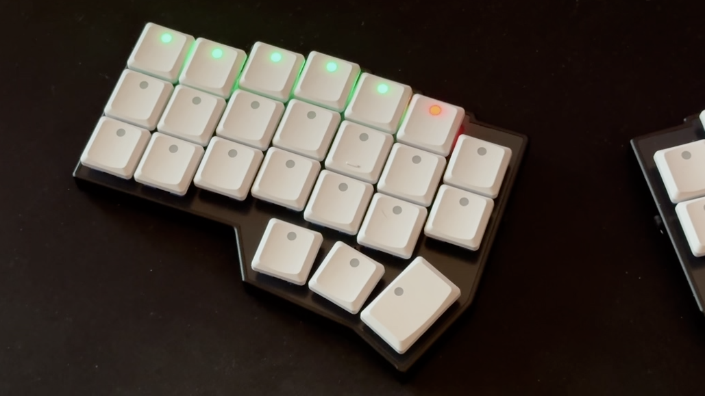
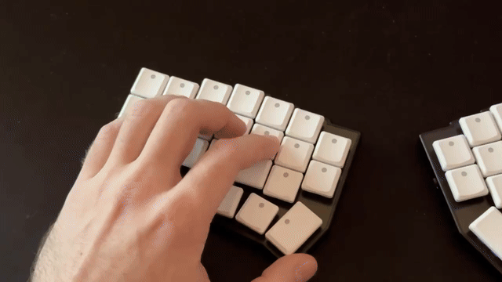

# ZMK Status LEDs



A custom [ZMK Firmware](https://zmk.dev/) module that uses your keyboard's addressable RGB LEDs (per-key or underglow WS2812/SK6812 strips) to display Bluetooth connection status and battery level. Eliminates need for status displays, allowing to use this space for additional keys on some boards such as corne v4.

Works with `CONFIG_ZMK_RGB_UNDERGLOW` - when a status indicator is triggered, any active underglow effect automatically pauses and resumes once the indicator finishes.

---

## Features & Behaviors

**Reporting statuses and led_discover work only on the master half.**

### 1. Bluetooth Connection Status (`&status_bt` + preview when switching profiles)

Triggered automatically whenever you switch Bluetooth profiles (e.g. `&bt BT_SEL 0`, `&bt BT_NXT`, `&bt BT_PRV`) or by using `&status_bt` behavior:

- **Status preview:** Shows current status of BT, by previewing all predefined slots + status of the current slot (active, waiting for connection, ready to pair)
- **Active Profile State:** The LED at `bt-leds[active_profile_index]` indicates the current state of that profile:
  - **Connected:** Solid Green
  - **Unoccupied (Pairing / Advertising Mode):** Flashes blue rapidly when ready for pairing
  - **Occupied (Waiting for Connection):** Blinks yellow slowly when waiting to reconnect
- **Auto-Restore:** After status timeout passes, automatically restores any previously active RGB underglow state.

---

### 2. Battery Level Bar (`&status_bat`)

Triggered by using `&status_bat`:

- **Dynamic Scaling:** Uses the LED indices listed in `battery-leds` as a proportional progress bar. The array can be **any length** (`N` LEDs), and each LED automatically represents $\frac{100\%}{N}$ of the battery capacity (rounded to the nearest slot)
- **Color Thresholds:**
  - **$\ge 50\%$ Battery:** Filled slots light up green, while the remaining empty slots light up red.
  - **$< 50\%$ Battery:** Filled slots light up orange to warn that charge is below half, while the remaining empty slots light up red.
- **Auto-Restore:** After status timeout passes, automatically restores any previously active RGB underglow state.

---

### 3. LED Ordering Discovery (`&led_discover`)

On most keyboards, addressable LEDs are wired in a snake/serpentine chain across the PCB traces (and often include underglow LEDs in the same chain), meaning physical LED index `0` is rarely the top-left key. `&led_discover` makes it easy to find the exact index of every key without guessing or reading PCB schematics:

- **Sequential Walk:** Pressing `&led_discover` pauses underglow and walks through the entire LED strip, lighting up one LED at a time (1 second by default)
- **Odd/even:** Even indices light up in green, while odd light up in blue
- **Stop:** Using `&led_discover` again canceles the walk
- **How to use:** Bind `&led_discover` to a key, point your camera at the keyboard and start the sequence. From the video one can figure out the correct indices for all the LEDs (they start at `0`). After mapping out the indices, it makes sense to remove this binding, as it is not needed otherwise.

---

## Installation

### 1. Add to `config/west.yml`

Add `zmk-status-leds` to `zmk-config/config/west.yml`:

```yaml
manifest:
  remotes:
    - name: zmkfirmware
      url-base: https://github.com/zmkfirmware
    - name: PiotrWolinski
      url-base: https://github.com/PiotrWolinski
  projects:
    - name: zmk
      remote: zmkfirmware
      revision: main
      import: app/west.yml
    - name: zmk-status-leds
      remote: PiotrWolinski
      revision: main
  self:
    path: config
```

### 2. Enable in `.conf` File

Add the following to the `.conf` file:

```ini
CONFIG_ZMK_STATUS_LEDS=y
```

### 3. Customization

| Option                                    | Default | Description                                        |
| :---------------------------------------- | :------ | :------------------------------------------------- |
| `CONFIG_ZMK_STATUS_LEDS_BRIGHTNESS`       | `32`    | Maximum RGB channel brightness (`1`–`255`)         |
| `CONFIG_ZMK_STATUS_LEDS_DURATION_MS`      | `3000`  | How long (ms) status stays lit                     |
| `CONFIG_ZMK_STATUS_LEDS_FAST_BLINK_MS`    | `150`   | Blink interval (ms) for pairing state              |
| `CONFIG_ZMK_STATUS_LEDS_SLOW_BLINK_MS`    | `500`   | Blink interval (ms) when waiting for connection    |
| `CONFIG_ZMK_STATUS_LEDS_DISCOVER_STEP_MS` | `1000`  | Duration (ms) per LED during `&led_discover`    |

---

## Keymap Configuration

In the `.keymap` file:

1. Include `<behaviors/status_leds.dtsi>`.
2. Define a `status_leds` block mapping the `battery-leds` and `bt-leds` indices.
3. Bind `&status_bat`, `&status_bt`.

```dts
#include <behaviors.dtsi>
#include <dt-bindings/zmk/keys.h>
#include <dt-bindings/zmk/bt.h>
#include <behaviors/status_leds.dtsi>

/ {
    status_leds {
        compatible = "zmk,status-leds";
        led-strip = <&led_strip>; // Optional if zmk,underglow chosen node is set

        // Subarray of LED indices for battery display
        battery-leds = <18 17 12 11 4 3>;

        // Subarray of LED indices for Bluetooth slots 0..4
        bt-leds = <16 13 10 5 2>;
    };

    keymap {
        compatible = "zmk,keymap";

        system_layer {
            bindings = <
                ...
                &trans  &bt BT_SEL 0  &bt BT_SEL 1  &bt BT_SEL 2   &bt BT_SEL 3  &bt BT_SEL 4
                &trans  &status_bat   &status_bt    &led_discover  &trans        &trans
                ...
            >;
        };
    };
};
```

---

## Features showcase

### Battery status


---

### Bluetooth status + profile switching



### LED discovery

---


---

## AI Notice

This work done with the help of AI agents (Gemini 4 Argon), tested on my very own keyboard (Corne Choc BT from keebart).
